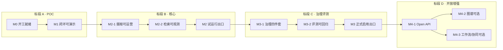

# 知枢 · 企业智能知识库 开发计划

> **产品**：知枢企业智能知识库（`zhishu-kb-platform`）  
> **版本**：v1.1 ｜ **日期**：2026-11-05 ｜ **状态**：执行中（单人）  
> **关联**：[PRD](./知枢企业智能知识库PRD.md) ｜ [技术方案](./知枢企业智能知识库技术方案.md) ｜ [开发排期](./知枢企业智能知识库开发排期.md) ｜ [**开发进度**](./开发进度.md)  
> **口径**：本文回答「按什么标段、哪些里程碑、谁做什么、做到什么算完」；需求以 PRD FR/NFR 为准，架构以技术方案为准；具体日期见排期；**勾选进度以开发进度为准**。

---

## 目录

- [1. 计划总览](#1-计划总览)
- [2. 组织与工作约定](#2-组织与工作约定)
- [3. 标段与里程碑总图](#3-标段与里程碑总图)
- [4. 标段 A：工程基座与 POC](#4-标段-a工程基座与-poc)
- [5. 标段 B：核心 RAG 与权限体系](#5-标段-b核心-rag-与权限体系)
- [6. 标段 C：知识治理与质量评测](#6-标段-c知识治理与质量评测)
- [7. 标段 D：开放能力与可选增强](#7-标段-d开放能力与可选增强)
- [8. 横切工作包（全标段并行）](#8-横切工作包全标段并行)
- [9. 依赖、关键路径与缓冲](#9-依赖关键路径与缓冲)
- [10. 质量门禁与发布节奏](#10-质量门禁与发布节奏)
- [11. 风险登记与应急预案](#11-风险登记与应急预案)
- [附录 A 任务编号全表](#附录-a-任务编号全表)
- [附录 B 修订记录](#附录-b-修订记录)

---

## 1. 计划总览

### 1.1 目标

在约 **10~17 周**（含按需标段 D）内，交付可内网私有化运行的知枢平台，达成 PRD 三条目标：

| 目标 | 对应里程碑出口 |
|------|----------------|
| G1 端到端可用 | **M1**（演示）→ **M2**（试运行） |
| G2 质量可运营 | **M3** |
| G3 治理可审计 | **M3** |
| 对外嵌入/扩展 | **M4**（按需） |

### 1.2 工期假设

| 项 | 假设 |
|----|------|
| 编制基准 | **2 人**（后端/AI 全栈 1 + 前端/交互 1），每周有效开发 **5 人日/人** |
| 单人模式 | 将下表「周」×1.4~1.6 作为日历周估算（约 14~16 周到 M3） |
| 日历起点 | 以 kickoff 日为 W0；下文「Wn」为相对周 |
| 硬件 | 开发期默认 **A 档**（或等价 CPU 联调）；M2 前完成 B 档试用机准备 |

### 1.3 工期包络

| 标段 | 名称 | 日历周（2 人） | 累计 | 对应 Phase |
|------|------|----------------|------|------------|
| **A** | 工程基座与 POC | W1（约 1 周） | 1 周 | Phase 0 |
| **B** | 核心 RAG 与权限 | W2~W5（3~4 周） | 4~5 周 | Phase 1 |
| **C** | 知识治理与评测 | W6~W9（3~4 周） | 7~9 周 | Phase 2 |
| **D** | 开放与可选增强 | W10~W17（4~8 周，可裁） | 按需 | Phase 3 |

> **正式启用建议卡点**：M3 通过后进入「试运行 → 正式启用」；标段 D 不阻塞正式启用。

---

## 2. 组织与工作约定

### 2.1 角色分工（RACI 简表）

| 角色 | 代号 | 主责 |
|------|------|------|
| 后端 / AI 工程 | BE | FastAPI、RAG、Celery、治理、评测、Compose AI 服务 |
| 前端 / 体验 | FE | Vue3 管理台、对话/引用、治理与评测看板、Widget |
| 产品 / 验收 | PO | 需求澄清、金标集组织、里程碑签收（可兼任） |
| 运维对接 | OPS | 内网机、镜像导入、备份策略（可兼任 BE） |

### 2.2 工程约定

1. **仓库**：Monorepo（`frontend/` `server/` `deploy/` `docs/`），分支 `main` 保护；功能分支 `feat/*`，里程碑打 tag `m1`/`m2`/`m3`/`m4-*`。
2. **接口先行**：每个里程碑首日冻结 OpenAPI 草案；FE/BE 用 Mock/契约并行。
3. **清洁室**：不引入第三方闭源产品源码/SDK；新依赖登记 LICENSE（见技术方案 §4.3）。
4. **Definition of Done（任务级）**：代码合入 + 单测/关键路径手测 + 文档/FR 勾选更新 + 无新增 AGPL 依赖。
5. **站会**：每日 15 分钟；每周五里程碑风险回顾；标段出口做正式 Demo + 签收清单。

### 2.3 环境分层

| 环境 | 用途 | 何时就绪 |
|------|------|----------|
| Dev | 本机 Compose 精简栈 | A 标段 D1 |
| Staging | 内网试用机（建议 B 档） | B 标段中期（M2-2 前） |
| Prod | 正式启用环境 | M3 签收后 |

---

## 3. 标段与里程碑总图



| 里程碑 | 标段 | 出口一句话 | 绑定 FR（主） |
|--------|------|------------|---------------|
| **M0** | A | 仓库/Compose/CI 骨架可跑空服务 | — |
| **M1** | A | 上传→解析→检索→流式回答→引用可点 | FR-01/03/04/08 最小集、FR-16 本地 |
| **M2-1** | B | 解析路由 + 流水线可运营 + 管理台知识库 | FR-01~03 |
| **M2-2** | B | 混合检索+RRF+Rerank 可观测；SSE 引用成型 | FR-04/05/08 |
| **M2** | B | RBAC+工作区+密级过滤；内网试运行 | FR-11 过滤、FR-12、FR-16 |
| **M3-1** | C | 有效期/归并/审计水印/表格注入/Hit Test | FR-06/07/09/10/11 |
| **M3-2** | C | RAGAS 夜间回归 + Trace + 看板 | FR-13/14 |
| **M3** | C | 治理+评测达标，可正式启用 | G2+G3 |
| **M4-1** | D | Chat API + 限流 + 签名 Widget | FR-15 |
| **M4-2** | D | 图谱审核门槛版（特性开关） | FR-17 |
| **M4-3** | D | 工作流和/或协同（按 ROI 二选一或都做） | FR-18/19 |

---

## 4. 标段 A：工程基座与 POC

> **工期**：约 1 周（W1）｜ **出口**：M1 ｜ **目标**：证明技术栈闭环，降低后续集成风险

### 4.1 里程碑 M0 — 开工就绪（D1~D1.5）

| 任务 ID | 工作项 | 角色 | 细节 | DoD |
|---------|--------|------|------|-----|
| A-001 | Monorepo 骨架 | BE+FE | 建 `frontend/` `server/` `deploy/` `docs/`；README 开发快速开始 | 空前后端可本地启动 |
| A-002 | Docker Compose 骨架 | BE | nginx / api / worker / pg(pgvector) / valkey / llm / tei / parse(Docling) 服务名就位；健康检查 | `compose up` 全绿或可诊断失败 |
| A-003 | 配置与密钥 | BE | `.env.example`、settings（Pydantic）、禁止提交密钥 | 文档列出必填项 |
| A-004 | Alembic + 最小表 | BE | users（可先单用户）、documents、chunks 雏形 | 迁移可重复执行 |
| A-005 | 前端脚手架 | FE | Vue3+Vite+TS+AntDV4+Pinia+路由；设计 token 初稿 | 空白布局页可访问 |
| A-006 | CI 基线 | BE | lint + 单测空跑 + 依赖 LICENSE 扫描脚本占位 | PR 可挂检查 |
| A-007 | 模型物料清单 | BE/OPS | Qwen3-4B GGUF、Embedding/Reranker 0.6B 下载与路径约定 | Dev 机能加载 |

**M0 签收**：任意开发者按文档 30 分钟内拉起空栈（不含首次下模型时间）。

### 4.2 里程碑 M1 — 闭环可演示（D2~D5）

| 任务 ID | 工作项 | 角色 | 细节 | DoD |
|---------|--------|------|------|-----|
| A-101 | 上传 API | BE | 单文件上传落盘；写 documents；返回 doc_id | Postman/OpenAPI 可测 |
| A-102 | 解析最小路径 | BE | 仅 Docling；输出统一 `ParsedDoc`；失败可查日志 | PDF/DOCX/MD 各 1 份成功 |
| A-103 | 分块 + 嵌入 | BE | 512 token/10% overlap；调 TEI `/embed`；写入 chunks.embedding | chunks 可查 |
| A-104 | Celery 摄取任务 | BE | 解析→分块→嵌入串行任务；状态 `pending/running/done/failed` | 前端或 API 可轮询进度 |
| A-105 | 向量检索 MVP | BE | 仅 pgvector topK；暂无全文/Rerank | 相关文档可召回 |
| A-106 | 生成 + SSE | BE | llama-server OpenAI 兼容流式；简易 prompt「仅依据资料」 | 浏览器 EventSource/fetch 可读流 |
| A-107 | 引用 MVP | BE | 返文档名+片段；前端可点击展示原文 snippet | Demo 可讲解 |
| A-108 | 最小对话页 | FE | 上传区 + 进度 + 对话框 + 引用侧栏 | 5 人内可用 |
| A-109 | 冒烟脚本 | BE | `make smoke`：上传样例→等 done→提问→断言有 citation | CI 或本地一键 |

**M1 签收清单（对齐 PRD M1）**

- [ ] Compose 一键起全栈（A 档参数）
- [ ] 上传 → 解析完成 → 提问 → 流式回答
- [ ] 引用可点开命中原文片段
- [ ] 团队 ≤5 人试用无阻断性缺陷
- [ ] 打 tag `m1`，Demo 录屏归档

**本标段明确不做**：RBAC、多工作区、Rerank、治理、评测、Open API。

### 4.3 标段 A 交付物

| 交付物 | 说明 |
|--------|------|
| 可运行 POC 环境 | Dev Compose |
| 冒烟脚本与样例文档包 | `fixtures/` |
| OpenAPI 初稿 v0 | 上传/文档状态/chat |
| 已知问题清单 | 解析失败样例、并发限制说明 |

---

## 5. 标段 B：核心 RAG 与权限体系

> **工期**：W2~W5（3~4 周）｜ **出口**：M2 ｜ **目标**：可内网试运行的「真」知识库

### 5.1 里程碑 M2-1 — 摄取可运营（约 W2）

| 任务 ID | 工作项 | 角色 | 细节 | DoD |
|---------|--------|------|------|-----|
| B-001 | 解析路由 FR-02 | BE | 类型探测：印刷体→Docling；复杂版面→MinerU；扫描件→PaddleOCR 预处理 | 路由表单测 + 三类样例 |
| B-002 | 解析结果下载 | BE+FE | 管理员可下载中间结果；失败死信可重试 | UI + API |
| B-003 | SHA-256 去重 FR-01 | BE | 同工作区秒级拒重或合并策略（产品确认一种） | 重复上传用例通过 |
| B-004 | 批量/拖拽上传 | FE | 多文件队列、进度条、失败重试入口 | 10 文件批量体验可接受 |
| B-005 | 分块透明化 | FE+BE | 分块列表（seq/页码/是否表格/token） | 管理员可巡检 |
| B-006 | 网页 URL 摄取 | BE | 抓取→清洗→走同一流水线 | 内网可达 URL 样例通过 |
| B-007 | 知识库管理台 | FE | 文档列表筛选、状态、删除/重跑 | 对齐信息架构「知识库」 |
| B-008 | 表格块标记 | BE | `is_table`；整表成块（为 FR-06 铺底） | 表类 PDF 抽样验证 |

**M2-1 签收**

- [ ] 混合格式批量入库成功率达约定阈值（建议 ≥90% 或失败原因可读）
- [ ] 解析路由三类引擎至少两类在 Staging 验证（MinerU 可按硬件裁剪）
- [ ] 分块详情可查

### 5.2 里程碑 M2-2 — 检索可观测（约 W3）

| 任务 ID | 工作项 | 角色 | 细节 | DoD |
|---------|--------|------|------|-----|
| B-101 | zhparser 全文 | BE | `tsv` 生成列 + GIN；中文分词冒烟 | 关键词问答可命中 |
| B-102 | 混合召回 + RRF FR-04 | BE | 两路 top50；应用层 RRF k=60；保留分路分数 | 单测覆盖融合公式 |
| B-103 | Rerank FR-05 | BE | TEI `/rerank`；top50→top8（可配置） | 延迟与效果有记录 |
| B-104 | 上下文组装 | BE | chunk 绑定 doc 元数据；忠实性 prompt 定稿 | 无资料时拒答话术统一 |
| B-105 | SSE 块协议 FR-08 | BE | `conversation_meta` / `block_start` / `block_delta` / `block_replace`+citations / `[DONE]` | 协议文档 + 兼容前端 |
| B-106 | 四类引用结构（前两类必达） | BE+FE | 引用库 + 参考来源先落地；图谱/配图占位 | UI 分区清晰 |
| B-107 | 多轮会话 | BE+FE | conversation 续接；历史侧栏 | 多轮不丢 conversation_id |
| B-108 | nginx SSE | OPS/BE | `proxy_buffering off`；超时调优 | 长回答不截断 |
| B-109 | 检索调试日志 | BE | 结构化日志：各路召回数、融合后、重排后（为 Hit Test 铺底） | Staging 可 grep |

**M2-2 签收**

- [ ] 关闭向量或关闭全文任一通路时，另一路仍可用（可观测）
- [ ] 流式块协议与引用面板联调通过
- [ ] 样例集上「有资料必有引用」抽测 ≥90%

### 5.3 里程碑 M2 — 试运行出口（约 W4~W5）

| 任务 ID | 工作项 | 角色 | 细节 | DoD |
|---------|--------|------|------|-----|
| B-201 | 工作区模型 FR-12 | BE | workspaces、成员、ORM 统一注入 workspace_id | 跨空间隔离用例 |
| B-202 | RBAC | BE | admin/librarian/auditor/member；依赖注入鉴权 | 权限矩阵文档 + API 拒绝用例 |
| B-203 | 登录与会话 | BE+FE | JWT/Session 选定一种；登录页；路由守卫 | 未登录不可访问业务 API |
| B-204 | 密级字段 + 过滤 FR-11(P0) | BE | L1~L4；`visibility_filter()` 挂在所有检索入口 | **自动化：无权不命中** |
| B-205 | 用户密级 clearance | BE+FE | 与角色正交；管理台可改 | 同角色不同密级行为正确 |
| B-206 | 管理台系统模块 | FE | 用户/角色/工作区 | 完成试运行所需配置自助化 |
| B-207 | 模型热切换 FR-16 | BE+FE | settings 存模型；控制台切换本地模型 | 新对话用新模型 |
| B-208 | 并发与排队 | BE | llama-server parallel/slot；过载友好错误 | A 档 2 路说明写入运维备忘 |
| B-209 | Staging 部署 | OPS | B 档或等价机；备份脚本初版 | 试用账号发放 |
| B-210 | 试运行缺陷收敛 | 全员 | P0/P1 bug 清零约定 | 签收会议纪要 |

**M2 签收清单（对齐 PRD M2）**

- [ ] FR-01~05、FR-08、FR-12、FR-16（本地）、密级过滤达标
- [ ] 密级漏检自动化用例 = 0 失败
- [ ] Staging 连续试用 ≥3 个工作日，无数据串空间事故
- [ ] 打 tag `m2`；试运行手册（账号、上传规范、已知限制）

**本标段明确不做（留给 C/D）**：有效期退休、旧稿归并、审计导出与水印、RAGAS、Open API、图谱。

### 5.4 标段 B 交付物

| 交付物 | 说明 |
|--------|------|
| 权限矩阵 v1 | 角色 × 资源操作 |
| 检索参数基线 | topK、RRF k、rerank N |
| 试运行手册 | 面向业务试用同学 |
| 自动化测试 | 隔离 + 密级过滤最低集 |

---

## 6. 标段 C：知识治理与质量评测

> **工期**：W6~W9（3~4 周）｜ **出口**：M3 ｜ **目标**：差异化能力落地 + 质量可运营 → **正式启用**

### 6.1 里程碑 M3-1 — 治理四件套（约 W6~W7）

| 任务 ID | 工作项 | 角色 | 细节 | DoD |
|---------|--------|------|------|-----|
| C-001 | 有效期模型 FR-09 | BE | documents/chunks `valid_from/to`；检索恒过滤 | 改期立即生效用例 |
| C-002 | 退休定时任务 | BE | Celery beat 每日扫描 `retired` + 审计 | 可手动触发扫描 |
| C-003 | 有效期管理 UI | FE | 文档/批量改期；列表展示状态 | 管理员可自助 |
| C-004 | 文档级聚合向量 | BE | 入库写 `doc_embedding` | 供归并比对 |
| C-005 | 相似度归并 FR-10 | BE | ≥0.92 强提示、0.80~0.92 弱提示；`superseded_by` 链 | 阈值可配置 |
| C-006 | 归并待办 UI | FE | 提示队列、确认/忽略、版本链可视化 | 对齐场景 S3 |
| C-007 | 现行稿过滤 | BE | 检索强制 `is_current`（可开「含历史」调试开关仅管理员） | 归并后默认不混答 |
| C-008 | 审计日志 FR-11 | BE | audit_logs 只增；关键动作全覆盖 | 导出 CSV/JSON |
| C-009 | 审计台 | FE | 按人/文档/时间筛选导出 | 审计员角色可用 |
| C-010 | 动态水印 | FE | L3+ 页用户+时间水印；不影响点击 | 截图验收 |
| C-011 | 表格全表注入 FR-06 | BE | 命中 `is_table` 注入全表 Markdown | 对照碎片注入的效果记录 |
| C-012 | Hit Test FR-07 | BE+FE | 持久化 `context_snapshot`；展示分路分数与注入全文 | 管理员入口 |
| C-013 | 治理模块信息架构 | FE | 「治理」导航聚合有效期/归并/审计 | 与 PRD §7.3 一致 |

**M3-1 执行快照（2026-11-05 晚）**

| 任务 | 状态 |
|------|------|
| C-001 有效期 + 检索过滤 | 完成 |
| C-002 退休扫描 | 完成（手动 API + stub 调度 / Celery beat） |
| C-003 有效期 UI | 完成（简版） |
| C-004~007 归并 | **完成（简版）**：doc_embedding + 待办确认/忽略 + is_current |
| C-008 / C-009 审计 + 导出 | 完成（简版台，含归并动作） |
| C-012 Hit Test 台 | **完成（简版）**：快照落库 + `/hit-test` 页 |
| C-011 表格注入 | **完成（简版）**：整表成块 + 注入序优先 |
| C-010 水印 | **完成（简版）**：L3+ 用户+时间水印 |
| C-013 治理 IA | **完成（简版）**：顶栏「治理」+ `/governance` |

**M3-1 签收**

- [x] 有效期演示（改期立即从检索消失）+ 密级（已有）+ 审计导出
- [x] 归并：相似提示 → 确认 → 旧稿不参与检索（手测）
- [x] Hit Test 可解释一次「为什么这样答」（分路 + 注入全文）
- [x] 表格命中整表注入（`expense_grades.md`）
- [x] 水印在涉密页可见
- [x] 治理导航聚合入口

### 6.2 里程碑 M3-2 — 评测可回归（约 W8）

| 任务 ID | 工作项 | 角色 | 细节 | DoD |
|---------|--------|------|------|-----|
| C-101 | 评测集数据模型 | BE | eval_sets / 金标条目（问/答/期望文档） | CRUD API |
| C-102 | 金标集 v0 | PO+BE | 真实业务 50~100 条；标注规范 | 入库 Staging |
| C-103 | RAGAS Runner FR-13 | BE | 四指标；结果落 eval_runs | 可手动跑通 |
| C-104 | 夜间回归 | BE | Celery beat；失败告警（邮件/日志） | 连续跑 2 夜成功 |
| C-105 | 参数对比跑 | BE | 变更分块/模型时双跑 diff | 报告可下载 |
| C-106 | 评测看板 | FE | ECharts 趋势；跑次详情 | 对齐「评测」模块 |
| C-107 | Langfuse 自托管 FR-14 | BE | Compose 服务；trace_id 回写 messages | 单次问答可打开 Trace |
| C-108 | 对话页 Trace 入口 | FE | 管理员可见 | 与 Hit Test 互补 |
| C-109 | 指标口径文档 | PO | 对外表述三要素模板 | 写入 docs |

**M3-2 签收**

- [x] 金标集可一键/定时跑通并落库
- [x] 看板可见历史跑次
- [x] 任选线上问答可关联 Trace（轻量 `zhishu-local`；Langfuse 可选升级）

### 6.3 里程碑 M3 — 正式启用出口（约 W9）

| 任务 ID | 工作项 | 角色 | 细节 | DoD |
|---------|--------|------|------|-----|
| C-201 | 云模型通道 FR-16 P1 | BE+FE | OpenAI 兼容；涉密可关 | 切换验收 |
| C-202 | 备份演练 | OPS | pg_dump + files 卷恢复演练；**stub 已用 SQLite online backup 演练** | 恢复成功纪要；见 [C202备份演练纪要](./C202备份演练纪要.md) |
| C-203 | 离线三开关验收 | OPS | 断网冷启冒烟 | NFR-01 |
| C-204 | 安全检查清单 | BE | 审计不可改、密钥、TLS | 勾选归档 |
| C-205 | 正式启用包 | 全员 | 发布说明、运维手册、权限矩阵终稿、培训 1 次 | 业务方签字 |
| C-206 | 缺陷与技术债冻结 | 全员 | 启用后仅修 P0；债项进 backlog | tag `m3` |

**M3 签收清单（对齐 PRD M3 / G2+G3）**

- [x] FR-06/07/09/10/11/13/14 达标（**FR-14=轻量自建**，非 Langfuse）
- [x] 治理四动作 + 审计导出演示
- [x] 评测基线建立（附四指标首报；金标 50 / heuristic）
- [x] 密级漏检 = 0（本用例）
- [x] 业务方同意「正式启用」或「有限启用」书面结论 ← **已勾有限启用**；见 [M3签收演示记录](./M3签收演示记录.md) §6

### 6.4 标段 C 交付物

| 交付物 | 说明 |
|--------|------|
| 治理操作手册 | 有效期/归并/密级/审计 |
| 金标评测集 v0 + 首报 | 含规模/指标/日期 |
| 正式启用检查表 | 签字版 |
| Hit Test / Trace 使用说明 | 管理员 |

---

## 7. 标段 D：开放能力与可选增强

> **工期**：W10~W17（4~8 周，可裁剪）｜ **不阻塞 M3 启用**｜ **按 ROI 分包交付**

### 7.1 里程碑 M4-1 — Open API 与 Widget（建议必做，约 2 周）

| 任务 ID | 工作项 | 角色 | 细节 | DoD |
|---------|--------|------|------|-----|
| D-001 | 助手绑定模型 | BE | 助手↔知识库范围↔密级上限 | 权限 ≤ 内部用户 |
| D-002 | API Key 生命周期 FR-15 | BE+FE | 创建/禁用/有效期；`Bearer zs-` | 泄露可单 Key 作废 |
| D-003 | Chat Open API | BE | SSE 块协议与内网一致；`/info` `/chat` | 三语言示例 |
| D-004 | RPM 滑动窗口限流 | BE | 单机内存→多实例 Valkey | 超限 429 |
| D-005 | 日配额 | BE | `api_usage_daily` UTC+8 重置 | 持久化跨重启 |
| D-006 | 调用日志导出 | BE+FE | 时间/IP/耗时/token | 审计联动 |
| D-007 | Widget 签名会话 | BE+FE | **禁止 Key 走 Query**；JWT+PostMessage | 安全复查通过 |
| D-008 | 嵌入文档与 Demo HTML | FE | 复制即用 | 对外文档站或 docs/ |

**M4-1 签收**：Key 全生命周期 + 限流 + 安全嵌入 Demo；tag `m4-api`。

### 7.2 里程碑 M4-2 — 知识图谱（可选，约 2~3 周）

**准入条件**：M3 评测集可跑；PO 批准做 A/B。

| 任务 ID | 工作项 | 角色 | 细节 | DoD |
|---------|--------|------|------|-----|
| D-101 | 特性开关 | BE+FE | 默认关；工作区级 | 关闭时零依赖 |
| D-102 | 抽取流水线 | BE | LightRAG 或等价 MIT 方案；增量跳过无变正文 | 任务可重跑 |
| D-103 | 审核门槛 FR-17 | BE+FE | pending/approved/rejected；仅 approved 参与 | 未审核不进检索 |
| D-104 | 检索注入 + 降级 | BE | 异常自动回退普通检索 | 混沌测试：杀图谱进程对话不中断 |
| D-105 | 引用第三类 + Hit Test | FE | 三元组展示 | 可解释 |
| D-106 | A/B 评测报告 | PO+BE | 开/关图谱四指标对比 | **非负才建议默认开** |
| D-107 | RBAC 覆盖实体可见性 | BE | 复用 visibility_filter | 密级用例扩展 |

**M4-2 签收**：开关+审核+降级+报告；tag `m4-graph` 或决定不做并关闭入口。

### 7.3 里程碑 M4-3 — 工作流 / 协同（可选，约 2~3 周，可拆）

**建议顺序**：先工作流（FR-18）或先协同（FR-19）二选一；两者都要则串行，避免并行抢人力。

#### 包 D3a 工作流

| 任务 ID | 工作项 | 角色 | 细节 | DoD |
|---------|--------|------|------|-----|
| D-201 | Vue Flow 画布 | FE | 检索/问答/通知节点 MVP | 可保存拓扑 |
| D-202 | 执行引擎 | BE | 同步/异步执行；复用同一权限与知识库 | 与对话权限一致 |
| D-203 | 事件触发器 | BE | 文档入库完成等 1~2 个事件 | 可关停 |
| D-204 | 运行日志 | FE | 失败可查 | 运维可排障 |

#### 包 D3b 协同编辑

| 任务 ID | 工作项 | 角色 | 细节 | DoD |
|---------|--------|------|------|-----|
| D-251 | TipTap 条目编辑 | FE | 知识条目 CRUD | 非办公套件范围 |
| D-252 | Yjs 协同 | BE+FE | y-websocket；权限随工作区 | 双人同编冒烟 |
| D-253 | 发布入库 | BE | 发布版本可进入摄取或直接成文档 | 与治理字段兼容 |

**M4-3 签收**：所选分包特性开关可用；tag `m4-flow` / `m4-collab`。

### 7.4 标段 D 裁剪原则

1. **M4-1 优先**：对外集成价值明确，且修复「Key 明文进 URL」类行业隐患，建议保留。  
2. **M4-2 看数据**：无 A/B 正向证据不开默认。  
3. **M4-3 看业务代言人**：无明确流程 owner 则不做工作流；无共创刚需则不做协同。

---

## 8. 横切工作包（全标段并行）

| 包 ID | 名称 | 节奏 | 内容 |
|-------|------|------|------|
| X-DOC | 文档同步 | 每里程碑 | PRD/技术方案/本文勾选；OpenAPI 发版说明 |
| X-LIC | 许可证门禁 | 每增依赖 | LICENSE 原文链接记入 `docs/adr/`；AGPL 拦截 |
| X-QA | 测试资产 | 每标段 | 单测（过滤/RRF/限流）+ 契约测 + 手工用例表 |
| X-SEC | 安全 | M2/M3/M4-1 | 密级、审计、Key、TLS、水印复查 |
| X-OPS | 部署物料 | M1 起 | offline 脚本、离线 bundle 清单、备份恢复 |
| X-UX | 体验与文案 | 并行 | 自主设计 token；错误文案统一；无第三方仿冒 |
| X-PERF | 性能备忘 | M2/M3 | 首 token、摄取吞吐、槽位占用记录，指导档位 |

建议每周五抽出 **0.5 人日** 做 X-DOC + X-LIC，避免期末补债。

---

## 9. 依赖、关键路径与缓冲

### 9.1 硬依赖链（关键路径）

```text
A-002 Compose → A-103 嵌入 → A-105 检索 → A-106 SSE → M1
M1 → B-001 路由 / B-102 RRF → B-105 协议 → B-204 密级过滤 → M2
M2 → C-001 有效期 & C-005 归并 & C-008 审计 → M3-1
M3-1 → C-102 金标 & C-103 RAGAS → M3
M3 → D-003 Open API → M4-1
M3 + 金标 → D-106 A/B →（可选）M4-2
```

### 9.2 可并行面（缩短日历）

| 并行组 | 说明 |
|--------|------|
| FE 管理台骨架 ∥ BE 摄取 | M1 后立即 |
| FE 对话/引用 ∥ BE RRF/Rerank | M2-2 |
| FE 治理 UI ∥ BE 有效期/归并 API | M3-1 |
| FE 看板 ∥ BE RAGAS/Langfuse | M3-2 |
| Widget UI ∥ Key/限流 API | M4-1 |

### 9.3 缓冲建议

| 位置 | 缓冲 | 用途 |
|------|------|------|
| M1 后 | 0.5 周 | 解析烂样例、显存争用 |
| M2 前 | 0.5~1 周 | 密级/隔离缺陷、Staging 环境扯皮 |
| M3 前 | 0.5 周 | 金标标注延期、RAGAS 耗时 |
| 标段 D | 整包可剪 | 不占用启用关键路径 |

---

## 10. 质量门禁与发布节奏

### 10.1 里程碑门禁（未通过不得宣告完成）

| 门禁 | M1 | M2 | M3 | M4-1 |
|------|----|----|----|------|
| 冒烟脚本 | ✓ | ✓ | ✓ | ✓（含 OpenAPI） |
| 密级自动化 | — | ✓ | ✓ | ✓（助手上限） |
| 工作区隔离 | — | ✓ | ✓ | ✓ |
| 审计导出 | — | — | ✓ | ✓（含 API 调用） |
| 评测首报 | — | — | ✓ | — |
| LICENSE 扫描 | ✓ | ✓ | ✓ | ✓ |
| Demo + 签收 | ✓ | ✓ | ✓ | ✓ |

### 10.2 版本号建议

| 版本 | 对应 |
|------|------|
| 0.1.0 | M1 |
| 0.2.0 | M2 |
| 1.0.0-rc | M3-2 |
| **1.0.0** | M3 正式启用 |
| 1.1.0 | M4-1 |
| 1.2.x | M4-2/3 按开关发版 |

### 10.3 缺陷分级（试运行起）

| 级 | 定义 | SLA（试运行） |
|----|------|----------------|
| P0 | 串数据、密级漏检、数据丢失、全站不可用 | 24h 内修复或回滚 |
| P1 | 主路径阻断（无法上传/无法答） | 3 个工作日 |
| P2 | 体验/文案/非主路径 | 进迭代 backlog |

---

## 11. 风险登记与应急预案

| ID | 风险 | 触发征兆 | 预案 |
|----|------|----------|------|
| R1 | 解析质量不达标 | M2-1 成功率 < 阈值 | 加人工补录；砍 MinerU 范围；表格验收单列 |
| R2 | 显存/CPU 不够 | M1 多人卡死 | 降 parallel；迁 Staging B 档；排队 |
| R3 | zhparser 安装失败 | M2-2 阻塞 | 切 pg_jieba/PGroonga；配置层切换 |
| R4 | 金标集无人标注 | M3-2 延期 | PO 抽 30 条最小集先跑；正式启用「有限」 |
| R5 | RAGAS 太慢 | 夜间跑不完 | 子集抽样；低峰；小裁判模型 |
| R6 | 图谱负收益 | A/B 变差 | 不开默认；保留开关 |
| R7 | 范围蔓延 | 强塞办公套件/SaaS | 回指 PRD §3.3；变更走书面 |
| R8 | 单人 bus factor | 关键模块无人接 | ADR + 结对回顾；文档 DoD 强制 |

---

## 附录 A 任务编号全表

> 便于看板建卡：建议列 = `待办 / 进行中 / 评审 / 完成`，标签 = `标段A|B|C|D` + `BE|FE|OPS|PO`。

| 前缀 | 标段 | 任务段 |
|------|------|--------|
| A-00x | A · M0 | 基座 |
| A-10x | A · M1 | POC 闭环 |
| B-00x | B · M2-1 | 摄取运营 |
| B-10x | B · M2-2 | 检索问答 |
| B-20x | B · M2 | 权限密级试运行 |
| C-00x | C · M3-1 | 治理 |
| C-10x | C · M3-2 | 评测 Trace |
| C-20x | C · M3 | 启用收口 |
| D-00x | D · M4-1 | Open API |
| D-10x | D · M4-2 | 图谱 |
| D-20x / D-25x | D · M4-3 | 工作流 / 协同 |
| X-* | 横切 | 文档/许可/测试/安全/运维/体验/性能 |

**任务密度统计（规划颗粒）**

| 标段 | 任务条数（约） | 说明 |
|------|----------------|------|
| A | 16 | 含 M0/M1 |
| B | 27 | 含三个子里程碑 |
| C | 28 | 含启用收口 |
| D | 8+7+8 | 可裁剪 |
| 合计 | **约 90+** | 不含子任务拆卡 |

---

## 附录 B 修订记录

| 版本 | 日期 | 变更 |
|------|------|------|
| v1.0 | 2026-11-02 | 初稿：四标段、M0~M4 多里程碑、任务级 WBS 与门禁 |
| v1.1 | 2026-11-05 | 关联开发进度；M3-1 执行快照（有效期/审计已完成，归并为下一步） |
| v1.2 | 2026-11-05 | 归并 C-004~007 标为完成；下一步 Hit Test 台 |

---

### 与 README 路线图对照

| README Phase | 本计划 |
|--------------|--------|
| Phase 0 | 标段 A → M1 |
| Phase 1 | 标段 B → M2 |
| Phase 2 | 标段 C → M3 |
| Phase 3 | 标段 D → M4-1/2/3 |

---

*知枢（zhishu-kb-platform）开发计划 ｜ 与 PRD / 技术方案配套 ｜ 里程碑签收以本文门禁为准*
