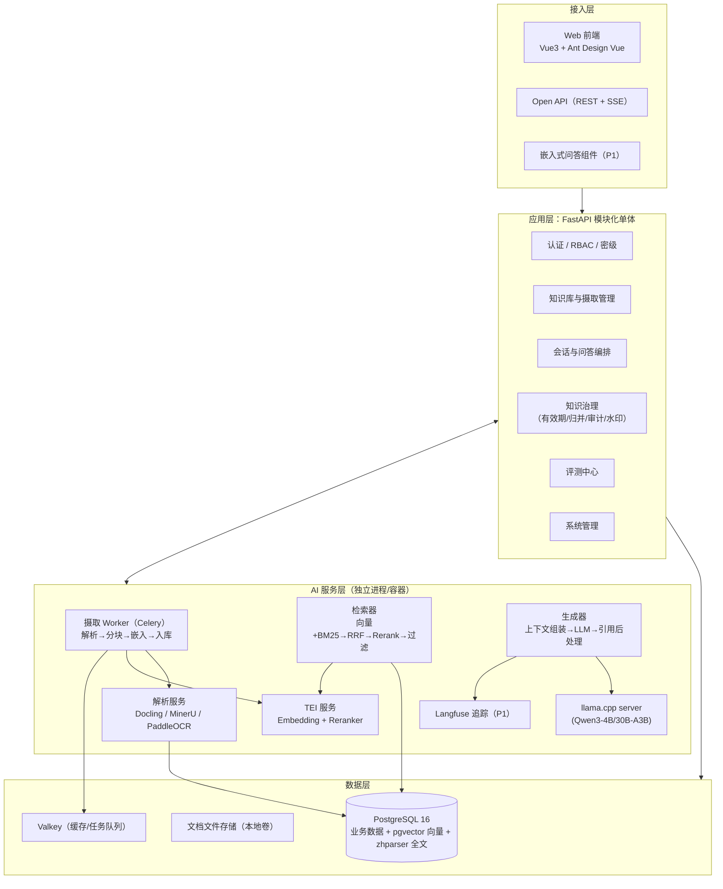
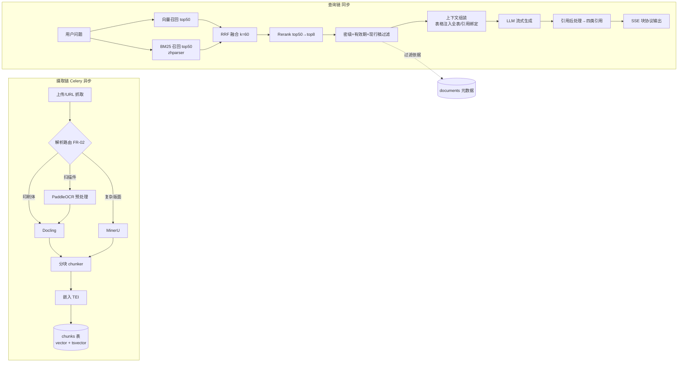
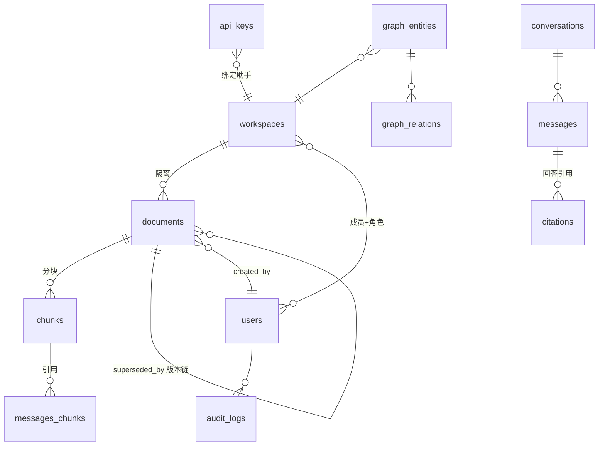

# 知枢企业智能知识库 技术方案

> **版本**：v1.1 ｜ **日期**：2026-10-31 ｜ **状态**：方案定稿（待评审）
> **产品定名**：知枢（全称「知枢企业智能知识库」，仓库 `zhishu-kb-platform`）——「枢」对应本项目最大差异化：**知识治理中枢**（有效期、旧稿归并、密级过滤、审计水印），而非简单的 RAG 问答
> **路线**：开源/公共组件组装自研（清洁室）——功能规格源自业界公开技术调研与通用工程实践的独立实现，不使用任何第三方闭源产品的源码、安装包与 SDK
> **合规基线**：全部组件为公开开源/公共组件；AGPL 组件零引入；独立开发（《计算机软件保护条例》第六条：软件著作权不延及思想、处理过程、操作方法；最高法 (2022)最高法知民终2171号：模仿功能重新编写、表达具实质差异者不构成侵权）
> **配套导图**：[知枢技术方案markmap](./知枢技术方案markmap.html)

---

<a id="toc"></a>
## 目录

- [§1 项目概述与建设原则](#sec-1)
  - [§1.1 定位与目标](#sec-1-1) ｜ [§1.2 建设原则](#sec-1-2) ｜ [§1.3 范围与边界](#sec-1-3)
- [§2 功能需求规格](#sec-2)
- [§3 总体架构设计](#sec-3)
  - [§3.1 架构分层图](#sec-3-1) ｜ [§3.2 服务拓扑](#sec-3-2) ｜ [§3.3 仓库结构](#sec-3-3) ｜ [§3.4 关键设计决策（ADR）](#sec-3-4)
- [§4 技术选型清单（开源/公共组件）](#sec-4)
  - [§4.1 选型原则](#sec-4-1) ｜ [§4.2 全栈选型总表](#sec-4-2) ｜ [§4.3 许可证合规声明](#sec-4-3)
- [§5 核心模块设计](#sec-5)
  - [§5.1 RAG 检索管线](#sec-5-1) ｜ [§5.2 知识治理层（自研核心）](#sec-5-2) ｜ [§5.3 权限与密级模型](#sec-5-3) ｜ [§5.4 评测体系](#sec-5-4) ｜ [§5.5 对外 API 与限流](#sec-5-5) ｜ [§5.6 模型接入层](#sec-5-6)
- [§6 数据模型设计](#sec-6)
- [§7 部署方案](#sec-7)
- [§8 实施计划](#sec-8)
- [§9 风险与依赖](#sec-9)
- [§10 知识产权与独立开发声明](#sec-10)
- [附录A 参考来源](#appendix-a) ｜ [附录B 修订记录与待办确认项](#appendix-b)

---

<a id="sec-1"></a>
## §1 项目概述与建设原则

<a id="sec-1-1"></a>
### §1.1 定位与目标

知枢是一套**企业级 AI 智能知识库系统**，核心能力面覆盖 RAG 检索问答、知识治理、质量评测闭环、开放 API 与私有化内网部署，完全由开源/公共组件组装 + 自研业务代码构成。系统面向企业内网（5~50 人共用），支持全离线运行，数据完全留存企业内部。

三条量化目标（对应验收）：① 端到端能力——上传→解析→索引→引用溯源问答全链路可用；② 质量可运营——RAGAS 四指标有基线并随迭代回归；③ 治理可审计——密级/有效期/归并/审计四项治理动作全部落地且可导出。

**明确不是什么**：知枢不是对任何第三方闭源产品的破解、反编译或代码移植；不采购第三方闭源产品源码；不引入其任何 SDK；不做界面仿冒。其功能规格来源于业界公开的功能描述与通用工程实践，全部独立实现——法律上，功能与架构思想不受著作权保护（见 §10）。

<a id="sec-1-2"></a>
### §1.2 建设原则

1. **清洁室**：开发人员不接触任何第三方闭源产品的代码与内部资料；仅依据公开功能描述与通用实践编写自己的实现。保留需求文档→设计→git 提交的独立开发证据链。
2. **开源优先、AGPL 零引入**：所有第三方组件从上游公共仓库获取；许可证以 MIT/Apache-2.0/BSD/PostgreSQL License 为优先序；AGPL/传染性 GPL 组件一律不引入（选型表逐项标注，见 §4.3）。
3. **许可证合规先于功能**：每次引入新依赖前核对 LICENSE 原文；内网自用为基线场景，同时保证未来「对外交付」路径不被许可证锁死。
4. **单体优先、按模块解耦**：小团队规模下用「模块化单体 + 独立 AI 服务进程」替代微服务全家桶（K8s/Prometheus 等在系统达到对应规模前不引入——避免企业级叙事与实际运维能力脱节）。
5. **数据主权**：业务数据、向量、文件、日志、模型全部落本机/本网；任何组件不得有出网行为（§7.3 离线三开关）。
6. **可解释优先于玄学**：分块可见、检索可测（Hit Test）、引用可溯源、评测可复现——把「准确率」做成可运营指标而非宣传口径。

<a id="sec-1-3"></a>
### §1.3 范围与边界

**P0（本期必做）**：文档摄取（PDF/Word/Markdown/网页/扫描件 OCR）、分块向量化、混合检索 + 重排、密级过滤、引用溯源问答、RBAC 与工作区隔离、基础管理控制台。
**P1（紧随其后）**：知识治理三件套（有效期 / 旧稿归并 / 审计水印）、RAGAS 评测中心、Hit Test 检索测试、对外 Open API + 两级限流。
**P2（按业务决策，均做成可开关，不进核心链路）**：知识图谱增强问答（LightRAG）、可视化工作流画布（Vue Flow）、协同富文本编辑（TipTap + Yjs）、嵌入式问答 Widget。
**明确不做**：OEM 贴牌体系、多租户 SaaS 订阅、多语言界面（仅 zh-CN）、协同表格/幻灯片等办公套件（不属于知识库赛道）。

裁剪依据：业界主流企业知识库的公开演进路径显示，知识库的核心价值在 P0+P1（检索问答 + 治理）；图谱/工作流/协同编辑属扩展形态，且图谱增强效果并不总是正向（主流方案普遍为其配置「异常自动降级」兜底），故在本方案中全部后置为可选增强。

---

<a id="sec-2"></a>
## §2 功能需求规格

需求按 FR-x 编号，供开发排期与验收引用。

| 模块 | 编号 | 需求（规格） | 优先级 |
|------|------|--------------|--------|
| 文档摄取 | FR-01 | 拖拽/批量上传 PDF、DOCX、MD、TXT、图片、网页 URL；重复文件 SHA-256 秒级去重 | P0 |
| 文档摄取 | FR-02 | 按文档类型路由解析引擎：印刷体→Docling；复杂版面/表格→MinerU；扫描件→PaddleOCR 预处理后再解析 | P0 |
| 摄取流水线 | FR-03 | 异步摄取：解析→分块→嵌入→入库四段流水线，进度可见、失败可重试、可下载解析结果 | P0 |
| 检索 | FR-04 | 混合检索：pgvector 向量召回 + zhparser 中文全文召回，应用层 RRF 融合（k=60） | P0 |
| 检索 | FR-05 | Rerank 精排：top50 → top8 注入，本地 Reranker 服务 | P0 |
| 检索 | FR-06 | 表格特殊注入：命中表格 chunk 时注入全表 Markdown 而非片段 | P1 |
| 检索 | FR-07 | Hit Test：单查询下可查看实际注入模型的完整上下文、各路召回分数 | P1 |
| 问答 | FR-08 | 流式多轮对话（SSE），回答附引用（文档名/页码/原文片段），四类引用结构（引用库/参考来源/图谱引用/正文配图各自独立） | P0 |
| 知识治理 | FR-09 | 知识有效期：文档/片段级 valid_from/valid_to，过期自动退休、不再参与检索 | P1 |
| 知识治理 | FR-10 | 旧稿识别归并：入库时相似度比对（≥0.92 强提示、0.80~0.92 弱提示），归并后默认只用现行稿，归并链可视化 | P1 |
| 知识治理 | FR-11 | 密级管控：L1~L4 四级，**检索层过滤**（无权用户不命中）；管理操作全量审计；前端动态水印（用户+时间） | P1（密级过滤 P0） |
| 权限 | FR-12 | RBAC + 工作区隔离：空间/角色/资源三级，检索与图谱均受控 | P0 |
| 评测 | FR-13 | RAGAS 四指标（faithfulness / answer relevancy / context precision / context recall）夜间定时回归，看板展示趋势 | P1 |
| 评测 | FR-14 | 每次问答全链路追踪（检索+生成），可按 trace 排查 | P1（Langfuse） |
| 开放 API | FR-15 | 对外 Chat API（SSE 块协议）+ Widget 嵌入；API Key 绑定助手、可禁用/有效期；两级限流（滑动窗口 RPM + 日配额）；调用日志审计 | P1 |
| 模型接入 | FR-16 | 模型可插拔：本地 llama.cpp/Ollama + 云 API（OpenAI 兼容）双通道，控制台切换 | P0（双通道 P1） |
| 图谱（可选） | FR-17 | 实体/关系抽取→**人工审核**→开启增强；注入片段可见；异常自动降级回普通检索 | P2 |
| 工作流（可选） | FR-18 | 画布编排检索/问答/通知节点，事件触发器 | P2 |
| 协同编辑（可选） | FR-19 | 知识条目在线共创（TipTap + Yjs，直用上游公共库） | P2 |

---

<a id="sec-3"></a>
## §3 总体架构设计

<a id="sec-3-1"></a>
### §3.1 架构分层图



分层要点：应用层是**一个 FastAPI 进程**按包分模块（§3.3），AI 能力全部拆为**独立服务进程**（LLM/TEI/解析各自容器化），通过 HTTP 互调——好处是任何 AI 组件可单独升级/替换/横向扩容（如换 24GB 卡只动 llama-server），且 6GB 显存机可把 OCR 与 LLM 分别调度（避免 GPU 争用，见 §7.1）。

<a id="sec-3-2"></a>
### §3.2 服务拓扑（Docker Compose 服务清单）

| 服务 | 镜像基线 | 职责 | 备注 |
|------|----------|------|------|
| nginx | nginx:stable-alpine | 前端静态托管 + API 反代 + SSE 透传（`proxy_buffering off`） | 对外唯一入口 |
| web | 构建产物（node 一次性构建） | 前端产物由 nginx 托管，不单独起服务 | — |
| api | python:3.12-slim 自建 | FastAPI + Uvicorn（uvicorn workers=2） | 含 Alembic 迁移 |
| worker | 同 api 镜像 | Celery worker（摄取/评测任务队列） | 与 api 同镜像不同命令 |
| beat | 同 api 镜像 | Celery beat（夜间评测、有效期扫描、审计归档定时任务） | — |
| llm | ghcr.io/ggml-org/llama.cpp:server（CUDA）或 CPU 镜像 | llama-server 多 slot 推理 | A/B/C 档参数见 §7.1 |
| tei | ghcr.io/huggingface/text-embeddings-inference:1.7（CPU） | Qwen3-Embedding-0.6B + Reranker-0.6B | GPU 档可换 cuda 镜像 |
| parse | mineru file-parse / docling-serve / paddleocr serving 三选一按档启用 | 文档解析独立服务 | 3.x 接口锁定 |
| pg | pgvector/pgvector:pg16 + zhparser | 业务+向量+全文同库 | 数据卷单独挂载 |
| valkey | valkey/valkey:8 | 队列 + 缓存 + RPM 限流计数（多实例时） | 替代 Redis 规避许可变化 |

启动顺序与依赖：pg/valkey → llm/tei/parse → api（迁移）→ worker/beat → nginx。全部服务在内网 compose 一键拉起，无外网依赖（§7.3）。

<a id="sec-3-3"></a>
### §3.3 仓库结构（Monorepo）

```
zhishu-kb-platform/
├── frontend/                     # Vue 3 + TS + Vite
│   ├── src/
│   │   ├── api/                  # OpenAPI 生成的客户端 + SSE 封装
│   │   ├── modules/
│   │   │   ├── knowledge/        # 文档/分块/摄取进度
│   │   │   ├── chat/             # 会话、引用面板、Hit Test 视图
│   │   │   ├── governance/        # 有效期/归并/密级/审计/水印
│   │   │   ├── eval/             # RAGAS 看板（ECharts）
│   │   │   └── admin/            # 用户/角色/工作区/模型配置
│   │   └── shared/               # 组件/水印/权限指令
├── server/                       # FastAPI 模块化单体
│   ├── app/
│   │   ├── main.py              # 装配与中间件（审计/水印上下文）
│   │   ├── core/                # 配置/安全(RBAC+clearance)/依赖注入
│   │   ├── api/v1/              # routers: documents/chat/admin/governance/openapi
│   │   ├── rag/                 # ingest/(parse_route, chunker, embed)
│   │   │                       # retrieve/(hybrid, rrf, rerank, filter)
│   │   │                       # generate/(assemble, llm_client, cite)
│   │   ├── governance/          # validity, dedupe_merge, classification, audit
│   │   ├── eval/                # ragas_runner, datasets
│   │   ├── models/             # SQLAlchemy ORM
│   │   └── schemas/            # Pydantic
│   ├── worker/                  # Celery app + tasks（ingest/eval/retire）
│   ├── alembic/                 # 迁移
│   └── tests/
├── deploy/
│   ├── docker-compose.yml       # 全服务编排
│   ├── docker-compose.gpu.yml   # C 档差异覆盖
│   ├── offline/                 # 离线物料：镜像 tar、模型清单、导入脚本
│   └── nginx/                   # nginx.conf（SSE 透传）
├── docs/                        # 本方案 + ADR + API 文档
└── Makefile                     # make dev / make up / make ingest ...
```

<a id="sec-3-4"></a>
### §3.4 关键设计决策（ADR 摘要）

| # | 决策 | 理由与后果 |
|---|------|-----------|
| ADR-1 | **模块化单体（FastAPI）而非微服务** | 团队规模小；该规模下微服务是伪需求（业界同级产品普遍「叙事重、落地轻」的教训）。后果：单进程横向扩展时以 uvicorn workers + 独立 AI 服务容器扩容代替 |
| ADR-2 | **PostgreSQL 单库承载业务+向量+全文（pgvector + zhparser）** | 一套备份/权限/事务覆盖全部数据；≤百万 chunks 远低于 pgvector 舒适区（业界公开口径 5000 万以下）；混合检索在应用层 RRF，不引入 ES 的运维面。后果：超千万级向量时迁移 Qdrant/Milvus 的预案写进 §9 |
| ADR-3 | **密级过滤做在检索层 SQL（WHERE），不在生成层遮蔽** | 无权用户对密级文档「不存在」而非「看到但被遮住」——既是安全边界也是可审计性的基础。后果：所有检索入口（含图谱/工作流）必须复用同一个 `visibility_filter()` |
| ADR-4 | **图谱/工作流/协同编辑为 P2 可开关模块，不进核心依赖** | 图谱增强收益不稳定（主流方案均需「异常自动降级」兜底）；核心链路保持简单是可靠性的根。后果：P2 模块通过特性开关（feature flag）接入 |
| ADR-5 | **前端 Ant Design Vue** | ① 团队既有技能栈一致；② 保持界面设计独立性（清洁室表达层要求）；③ MIT 许可、生态成熟 |
| ADR-6 | **推理引擎首选 llama.cpp llama-server，Ollama 作为易用替代** | 多 slot/KV 池/KV 量化/上下文预算全部显式可控（`--parallel --kv-unified-per-slot -ctk q8_0 --offline`），内网多用户必须显式调参；Ollama 黑盒参数适合个人快速验证 |
| ADR-7 | **解析引擎路由制（Docling 基础 / MinerU 高保真 / PaddleOCR 扫描件）** | 解析无银弹（业界实测共识）：按类型路由 + 可插拔是当前最稳架构决策；Docling（MIT，官方支持气隙）为默认，MinerU（Apache 2.0+附加条款，内网零义务，见 §4.3）处理复杂版面，PaddleOCR 预处理扫描件 |
| ADR-8 | **评测（RAGAS）与追踪（Langfuse）作为「功能」开发，不是上线后补** | 运营与对外承诺都需要可复现指标；Langfuse 为 MIT 核心、可自托管。后果：P1 排期内固定投入 |

---

<a id="sec-4"></a>
## §4 技术选型清单（开源/公共组件）

<a id="sec-4-1"></a>
### §4.1 选型原则

① 优先 MIT/Apache-2.0/BSD/PostgreSQL License；② 有活跃社区与清晰版本路线；③ 每项都有可替换备选（无供应商锁定）；④ **AGPL 零引入**；⑤ 与本项目功能相关的第三方闭源产品及其开发组织的全部产物一律不引入——即使其中部分为宽松许可证也统一回避，以保持清洁室边界的清晰可证明性。

<a id="sec-4-2"></a>
### §4.2 全栈选型总表

| 层 | 组件 | 版本基线 | 许可证 | 用途 | 替代方案 |
|----|------|----------|--------|------|----------|
| 前端框架 | Vue 3 + TypeScript + Vite | 3.5 / 5.x | MIT | SPA | React 系 |
| UI 组件库 | Ant Design Vue | 4.x | MIT | 管理界面 | Element Plus / Naive UI |
| 状态管理 | Pinia | 2.x | MIT | — | — |
| 图表 | Apache ECharts | 5.x | Apache-2.0 | 评测看板/审计统计 | — |
| Markdown 渲染 | markdown-it | 14.x | MIT | 回答渲染/知识条目 | unified |
| 工作流画布（P2） | Vue Flow | 1.x | MIT | FR-18 | — |
| 富文本+协同（P2） | TipTap v2 core + Yjs + y-websocket | 2.x / 13.x | MIT | FR-19（直用上游公共库） | Milkdown |
| 后端框架 | FastAPI + Pydantic v2 + SQLAlchemy 2.0 + Uvicorn | 0.12x / 2.x | MIT（BSD-3 SQLAlchemy） | API 单体 | NestJS（如全 TS 偏好） |
| 异步任务 | Celery + Valkey | 5.x / 8.x | BSD-3 | 摄取/评测/定时 | arq / Dramatiq |
| LLM 编排 | LangChain（Core，轻量使用） | 0.3+ | MIT | 提示组装/文本分割工具 | LlamaIndex / 直接裸调 API |
| 推理引擎 | llama.cpp llama-server（主）/ Ollama（备） | 最新稳定 | MIT | Qwen3 推理，多 slot 并发 | vLLM（C 档高吞吐时） |
| LLM 模型 | Qwen3-4B-Instruct-2507（A/B 档）· Qwen3-30B-A3B-Instruct-2507（C 档）· Q4_K_M | 2507 | Apache-2.0 | 问答主模型 | GLM-4.7-Flash、DeepSeek-R1-Distill（备用分析） |
| Embedding | Qwen3-Embedding-0.6B（TEI 服务化）/ bge-m3 | — | Apache-2.0 / MIT | 向量化（1024/2560 维） | bge-m3（8192 长文档场景） |
| Reranker | Qwen3-Reranker-0.6B / bge-reranker-v2-m3 | — | Apache-2.0 / MIT | 精排 top50→top8 | — |
| OCR | PaddleOCR 3.x（PP-OCRv6） | 3.x（锁大版本） | Apache-2.0 | 扫描件 OCR 层 | RapidOCR |
| 版面解析（默认） | Docling + docling-serve | 2.x | MIT | PDF/Office 版面解析，官方支持气隙环境 | — |
| 版面解析（高保真，C 档） | MinerU | 4.x | **MinerU 开源许可**（Apache 2.0 + 附加条款，见 §4.3） | 复杂版面/表格/公式 | RAGFlow DeepDoc |
| 向量+全文 | PostgreSQL 16 + pgvector + zhparser | pgvector 0.8+ | PostgreSQL License（类 BSD） | 向量检索 + 中文全文 | Qdrant（原生混合检索） |
| 缓存/队列 | Valkey | 8.x | BSD-3 | 队列/缓存/限流计数 | Redis 7.2（许可证注） |
| 评测 | RAGAS | 最新稳定 | Apache-2.0 | FR-13 四指标 | DeepEval |
| 追踪（P1） | Langfuse（self-host） | v2/v3 | MIT（核心） | FR-14 全链路 trace | 自建 trace 表 |
| 图谱（P2） | LightRAG | 最新稳定 | MIT | FR-17 | nano-graphrag |
| 基础设施 | Docker Compose + Nginx | — | Apache-2.0 | 单机编排/反代 | K8s（规模后置） |

<a id="sec-4-3"></a>
### §4.3 许可证合规声明

**零引入清单（本项目硬红线）**：
1. 任何第三方闭源产品的软件本体、安装包、镜像、源码、内部文档，及其开发组织的全部产物（SDK、开源仓库等）——即使部分为宽松许可证也统一回避，保持清洁室边界可证明；
2. AGPL-3.0 组件（如 QAnything、MinIO 等）——即使原样内网使用合规，也为规避解释争议一律不引入；
3. GPL-3.0 组件（如 MaxKB）不作为代码依赖引入（GPL 传染性只在「对外分发衍生作品」时触发，内网合规，但本项目自研代码不与 GPL 代码混合，保持未来对外交付的完全自由）。

**已核实的边界条款**（原文抓取于 2026-10-31）：
- **MinerU 4.x**：许可证为「MinerU Open Source License = Apache 2.0 + 附加条款」——① 商用免费，仅当 MAU>1 亿或月收入>2000 万美元才需单独商业授权；② **仅当基于 MinerU 向第三方提供在线服务时**才需在界面/文档显著标注「使用了 MinerU」；③ 违反则自动终止。**结论：内网自用零义务**；未来若对外提供服务，加一行署名即可（来源：https://gcore.jsdelivr.net/gh/opendatalab/MinerU@master/LICENSE.md ）。
- **GPL/AGPL 内网使用义务**（GNU 官方 FAQ 原文）：原样或修改后内网自用，GPL 无任何义务（"Nothing."）；AGPL 修改后内网属字面灰区——本项目已通过「AGPL 零引入」策略结构性规避，无需依赖灰区解释（来源：https://www.gnu.org/licenses/gpl-faq.html ）。
- **Redis 许可证变化**：Redis 7.4+ 转为 RSALv2/SSPL 双许可，故选型 Valkey（BSD-3，drop-in 替代）。
- **组件引入流程**：新依赖合入前，提交 LICENSE 原文链接 + 许可证类型到 `docs/adr/` 记录；升级大版本时复核。

---

<a id="sec-5"></a>
## §5 核心模块设计

<a id="sec-5-1"></a>
### §5.1 RAG 检索管线



**摄取链设计要点**：
- **解析路由**（FR-02）：上传时探测文档类型 + 是否含可选文本层 → 路由表决定引擎；每类结果统一为内部 `ParsedDoc`（blocks: text/table/image + page_no + bbox）；解析结果可下载，失败进死信队列可重试。
- **分块**：默认 512 token / 10% 重叠，标题感知（Docling/MinerU 的 heading 结构）；表格整表成块并打 `is_table` 标记；分块详情对管理员可见（「分块透明化」是可解释性设计的第一步）。
- **嵌入**：批量调 TEI `/embed`；文档级另存一个聚合向量（用于旧稿归并比对，见 §5.2）。
- **全文索引**：`tsv` 由 PG 生成列（`to_tsvector('zh', content)`，zhparser 提供中文分词）+ GIN 索引。

**查询链设计要点**：
- **RRF 融合**在应用层实现（`score = Σ 1/(k + rank)`，k=60），保留两路各自分数用于 Hit Test 展示；
- **Rerank**：TEI `/rerank`，query 与 top50 候选逐对打分取 top8；
- **过滤**（FR-11/FR-09/FR-10）：RRF 之后、注入之前统一执行 `visibility_filter`：`classification <= :clearance AND active AND now() BETWEEN valid_from AND valid_to AND is_current`；pgvector 0.8+ 的迭代索引扫描（iterative scan）保证带 WHERE 的向量检索不塌性能；
- **上下文组装**：命中 `is_table` chunk → 注入全表 Markdown（FR-06）；每条注入片段记录 chunk_id → 生成引用 {document_id, title, page_no, snippet}；
- **生成**：llama-server OpenAI 兼容接口流式输出；prompt 模板含「仅依据给定资料回答，未命中如实说明」的忠实性约束；
- **SSE 输出**（块式协议设计，见 §5.5）。

<a id="sec-5-2"></a>
### §5.2 知识治理层（自研核心，本方案最高价值模块）

知识治理是业界开源方案集体缺位、而企业级场景（尤其金融/合规行业）刚需的能力面——自研把它做成一级模块，即形成产品核心差异化（这也是产品定名「知枢」的由来）。

**① 知识有效期（FR-09）**
- `documents.valid_from / valid_to`（NULL=永久）；片段级覆盖（`chunks.valid_to` 可短于文档）；
- Celery beat 每日 02:00 扫描置 `status=retired` 并写审计；**检索 SQL 恒带时间过滤**（即使未及时扫描，过期知识也不会被检索）；
- 场景：费率表、制度文件、监管规则——「AI 不会拿旧制度回答新问题」。

**② 旧稿识别与归并（FR-10）**
- 入库时以文档聚合向量与现行（active + is_current）文档比对：`sim ≥ 0.92` 强提示（默认建议归并）、`0.80 ≤ sim < 0.92` 弱提示（人工决策）；SHA-256 完全相同直接秒级去重；
- 归并动作：旧稿 `superseded_by = new_id`、`is_current = false`、写审计；回答默认仅用 `is_current`（检索 SQL 内），旧稿保留可查（溯源场景）；
- 归并关系成链（A→B→C），管理界面可视化版本链。

**③ 密级管控 + 审计 + 水印（FR-11）**
- 四级密级 L1 公开 / L2 内部 / L3 秘密 / L4 机密；用户持 `clearance`（取其可访问的最高级）；
- **过滤在检索层**（ADR-3）：密级文档对无权用户「不存在」——向量召回、BM25 召回、（未来）图谱召回全部经同一 `visibility_filter()`；
- 审计：`audit_logs` 记录登录/检索/问答命中密级文档/文档管理/归并/密级变更/导出，字段含 who/what/when/ip/doc_id/result；管理台可按人/按文档/按时间导出；
- 动态水印：前端对含 L3+ 内容的页面叠加含 `userId + 时间戳` hash 的半透明水印层（CSS pointer-events:none），防拍照外传的最小可行实现。

**④ 图谱增强的治理门槛（P2，FR-17）**：实体/关系抽取结果进 `graph_entities/graph_relations` 表，`review_status ∈ {pending, approved, rejected}`；**仅 approved 实体参与图谱检索**；图谱服务异常自动降级为普通检索（对话不中断，业界主流图谱方案的通行兜底设计）；注入的三元组片段在 Hit Test 中可见。

<a id="sec-5-3"></a>
### §5.3 权限与密级模型

- **主体**：`users` ↔ `roles`（admin / librarian / auditor / member），角色挂于工作区：`workspace_members(workspace_id, user_id, role_id)`；
- **资源**：workspace → document → chunk 三级；空间之间硬隔离（所有业务表带 `workspace_id`，ORM 层统一注入）；
- **密级**：独立于角色的一维（一个 member 也可以有 L3 clearance，一个 admin 未必有 L4）——因为密级回答的是「能不能看」，RBAC 回答的是「能做什么」；
- **实现**：FastAPI 依赖注入链 `get_current_user → require_workspace_role → require_clearance(level)`；所有检索入口（REST/SSE/OpenAPI）共用；
- **Open API 的助手**（FR-15）：助手绑定知识库范围与密级上限，外部调用以助手身份过滤——对外 Key 的权限永远 ≤ 任一内部用户。

<a id="sec-5-4"></a>
### §5.4 评测体系

- **评测集**：`eval_sets` 维护金标问答对（问题 + 期望答案 + 期望命中文档）；建议初始 50~100 条，从真实业务问题中沉淀，人工标注；
- **夜间回归**：Celery beat 每晚全量跑 RAGAS 四指标（faithfulness 忠实度 / answer relevancy 答案相关度 / context precision 上下文精确率 / context recall 上下文召回率）→ `eval_runs` 落库 → 管理台 ECharts 趋势图（评测看板 + 夜间自动评测是业界 RAG 质量运营的通行形态）；
- **变更触发**：分块策略/模型/检索参数变更时，除夜间定时外支持手动触发对比跑（新旧参数双跑 diff）；
- **在线追踪**（P1）：Langfuse 自托管记录每次问答的完整 trace（两路召回分数 → 融合 → 重排 → 注入上下文 → 生成 token 数/延迟），按 conversation 串联回放——这是 Hit Test 的生产版（FR-07 是管理员手工版）；
- **指标口径**：对外承诺任何准确率数字前，必须附「评测集规模 + RAGAS 四指标值 + 评测日期」三要素（不做无口径指标宣传）。

<a id="sec-5-5"></a>
### §5.5 对外 API 与限流

**SSE 块协议**（块式流式协议，自研实现；块结构天然支持图文混排与多段引用）：

```
event: conversation_meta   data: {"conversation_id": "..."}          # 多轮续接
event: block_start         data: {"block_id": 1, "type": "text"}      # 新内容块（loading 态）
event: block_delta         data: {"block_id": 1, "delta": "..."}      # 流式增量
event: block_replace      data: {"blocks": [{"type": "text",
        "content": "...最终内容...",
        "citations": [{"doc_id": 12, "title": "xxx制度", "page": 3, "snippet": "原文片段"}]}]}
event: [DONE]                                                        # 流结束
```

**鉴权与管控**：
- 对外 Key：`Authorization: Bearer zs-xxx`；**一个 Key 绑定一个助手**（泄露单独禁用不影响其他 Key）；Key 可设有效期（临时授权场景）；
- **两级限流**：RPM 用滑动窗口计数（单机进程内存实现，多实例时迁 Valkey `INCR+EXPIRE` 窗口）；日配额用 `api_usage_daily(key_id, date, count)` 表计数、**UTC+8 零点重置**（持久化、跨重启不丢）；
- **调用日志**：时间/IP/耗时/token 用量落库可导出（审计联动 FR-11）；
- **安全设计要点**：**Key 不走 URL Query**——业界部分嵌入式 Widget 以 URL Query 明文传 Key，存在 Referer/日志/分享链泄露面，本方案不予采用；嵌入式组件改为「短期签名 JWT + PostMessage 换取会话」模式。

<a id="sec-5-6"></a>
### §5.6 模型接入层

- **本地通道（默认）**：llama-server `--offline` 模式，OpenAI 兼容 `/v1/chat/completions`；模型配置存 `settings` 表，控制台热切换（「改配置即换模型，无需改接入代码」）；
- **云通道（P1）**：任意 OpenAI 兼容 endpoint（DeepSeek/通义/自建网关）备用——信创/涉密环境保持纯本地，云通道仅在不涉密场景启用；
- **Embedding/Rerank 本地化**：TEI 容器化，模型文件预置（离线物料见 §7.3）；
- **并发预算显式化**：`--parallel N`、`--kv-unified-per-slot`、`-ctk q8_0` 写进部署配置基线（内网多用户不得依赖默认值）。

---

<a id="sec-6"></a>
## §6 数据模型设计

核心实体关系（简表，完整 DDL 见 Alembic 迁移）：



关键表 DDL 要点（PostgreSQL 16）：

```sql
-- 文档主表（治理字段是重点）
CREATE TABLE documents (
  id BIGSERIAL PRIMARY KEY,
  workspace_id BIGINT NOT NULL REFERENCES workspaces(id),
  title TEXT NOT NULL,
  source_type TEXT NOT NULL,              -- upload|web|api
  file_path TEXT, sha256 CHAR(64),         -- 秒级去重键
  classification SMALLINT NOT NULL DEFAULT 2,   -- L1~L4
  valid_from TIMESTAMPTZ NOT NULL DEFAULT now(),
  valid_to TIMESTAMPTZ,                   -- NULL=永久
  status TEXT NOT NULL DEFAULT 'active',   -- active|retired|superseded
  is_current BOOLEAN NOT NULL DEFAULT TRUE,
  superseded_by BIGINT REFERENCES documents(id),
  doc_embedding VECTOR(1024),             -- 文档级聚合向量（旧稿归并比对用）
  created_by BIGINT NOT NULL REFERENCES users(id),
  created_at TIMESTAMPTZ NOT NULL DEFAULT now()
);

-- 分块表（向量+全文+治理三合一）
CREATE TABLE chunks (
  id BIGSERIAL PRIMARY KEY,
  document_id BIGINT NOT NULL REFERENCES documents(id) ON DELETE CASCADE,
  workspace_id BIGINT NOT NULL,           -- 冗余，空间硬隔离
  seq INT NOT NULL,
  content TEXT NOT NULL,
  is_table BOOLEAN NOT NULL DEFAULT FALSE,
  page_no INT,
  token_count INT,
  classification SMALLINT NOT NULL,       -- 继承文档，可片段级提升
  active BOOLEAN NOT NULL DEFAULT TRUE,
  embedding VECTOR(1024) NOT NULL,
  tsv TSVECTOR GENERATED ALWAYS AS (to_tsvector('zh', content)) STORED
);
CREATE INDEX ON chunks USING hnsw (embedding vector_cosine_ops);
CREATE INDEX ON chunks USING gin (tsv);

-- 会话与引用
CREATE TABLE messages (
  id BIGSERIAL PRIMARY KEY,
  conversation_id BIGINT NOT NULL,
  role TEXT NOT NULL,
  content TEXT NOT NULL,
  citations JSONB,                         -- [{doc_id,title,page,snippet}]
  context_snapshot JSONB,                 -- Hit Test：实际注入内容+两路分数
  latency_ms INT, tokens INT, trace_id TEXT,  -- trace_id → Langfuse
  created_at TIMESTAMPTZ DEFAULT now()
);

-- 审计与配额
CREATE TABLE audit_logs (
  id BIGSERIAL PRIMARY KEY,
  user_id BIGINT, action TEXT NOT NULL,   -- login|search|chat_hit_classified|doc_merge|...
  doc_id BIGINT, ip INET, detail JSONB,
  created_at TIMESTAMPTZ NOT NULL DEFAULT now()
);
CREATE TABLE api_usage_daily (
  key_id BIGINT NOT NULL, day DATE NOT NULL, count BIGINT NOT NULL DEFAULT 0,
  PRIMARY KEY (key_id, day)
);
```

设计说明：① 治理三字段（classification/valid/is_current）**同时存在于 documents 与 chunks**——过滤在 chunk 级执行（检索对象是 chunk），管理在 document 级；② `context_snapshot` 即 Hit Test 的持久化（「检索过程透明化」的数据基础）；③ `api_usage_daily` 主键天然支持 UPSERT 原子自增，日配额跨天自动滚动；④ 向量维度 1024 对应 Qwen3-Embedding-0.6B 默认（C 档升 4B 模型时为 2560，随配置迁移）。

---

<a id="sec-7"></a>
## §7 部署方案

<a id="sec-7-1"></a>
### §7.1 三档硬件配置（部署调研结论，官方口径为主）

| 档位 | 硬件 | 适用 | LLM/推理参数基线 |
|------|------|------|------------------|
| A 档 | RTX 3060 Laptop 6GB / 16GB 内存 | ≤5 人（POC/小团队） | Qwen3-4B-2507 Q4（2.5GB）+ `llama-server -np 2 --kv-unified-per-slot 8192 -ctk q8_0`；OCR/解析全走 CPU |
| B 档 | 8~16 核 CPU / 32~64GB，无 GPU | **10~30 人（主力档）** | Qwen3-4B-2507 Q4 CPU（`-t 8`）+ TEI CPU + PaddleOCR CPU（官方口径约 1.4s/页）+ MinerU basic/ONNX 档 |
| C 档 | 16~24GB 单卡服务器 | 30~50 人 / 质量优先 | Qwen3-30B-A3B-2507 Q4（19GB）`-np 4~8`；或 vLLM 8B fp16/14B AWQ；MinerU standard 档 |

6GB 显存并发账本（按公开架构参数推算，与既有实测互证）：4B Q4 装载后余 ~3.4GB → KV q8_0 可支撑 16K~20K token 并发上下文总量 = 「2 路×8K 稳、4 路×4K 可行」。**铁律：A 档不与 GPU OCR/ASR 争显存**。

<a id="sec-7-2"></a>
### §7.2 部署编排

单机 Docker Compose（§3.2 服务清单）一键起全栈；前端构建产物与全部镜像在联网机 `docker save` 后导入；数据卷：`pg_data`（含向量）、`files`（原始文档）、`models`（GGUF/TEI/OCR 模型）、`langfuse_data`（P1）。备份 = `pg_dump` + files 卷 rsync（业务/向量/全文同库，一套备份全覆盖——ADR-2 的直接收益）。

<a id="sec-7-3"></a>
### §7.3 全离线部署流程

1. **联网制备机**：`docker compose build` → `docker save` 全部镜像 → ModelScope 批量拉取模型（Qwen3-4B-2507 GGUF、Qwen3-Embedding-0.6B、Qwen3-Reranker-0.6B、PaddleOCR 3.x 模型目录、MinerU/Docling 模型包）→ 打 `offline-bundle.tar`；
2. **内网导入**：`docker load` + 模型目录解压至 `models` 卷 + `make migrate` + 建初始管理员；
3. **离线三开关**：llama-server `--offline`；Ollama 场景 `OLLAMA_NO_CLOUD=1`；`MINERU_TELEMETRY_DISABLED=1`；容器全部 `restart: unless-stopped`，无任何自动更新；
4. **验收**：断网冷启全链路冒烟（上传→解析→问答→引用），确认无出网流量。

<a id="sec-7-4"></a>
### §7.4 运维基线

- **升级**：模型/镜像锁版本（镜像 tag 精确、GGUF 记录 SHA），「联网机验证→内网灰度单用户→全员」三步；应用升级走 Alembic 迁移，先备份后执行；
- **监控**：P0 用 `llama-server --slots` 端点 + Celery flower 观测并发与队列；Prometheus/Grafana 在规模跨档（>30 人或双机）时再上（ADR-1 的规模边界）；
- **安全**：内网 TLS 由 nginx 终结（自签/企业 CA）；管理台双因素可后置；审计表只增不改（应用层禁 UPDATE/DELETE 权限）；
- **容量**：100 万 chunks（≈数十万页）估算占 PG 内存 8~12GB（推算口径）——B 档 32GB 可承载，超此规模触发 Qdrant 迁移预案（§9）。

---

<a id="sec-8"></a>
## §8 实施计划

| 阶段 | 周期 | 内容 | 出口标准 |
|------|------|------|---------|
| **Phase 0：POC** | 1 周 | Compose 全栈起服务；Qwen3-4B + TEI + Docling 跑通「上传→解析→检索→流式回答→引用」闭环；前端最小问答界面 | 团队 5 人内试用，引用可点开命中原文 |
| **Phase 1：核心** | 3~4 周 | FR-01~05/08/12/16：解析路由、混合检索+RRF+Rerank、SSE 四类引用、RBAC+工作区+密级过滤、管理台骨架、模型热切换 | 密级文档无权不命中（自动化测试覆盖）；两路检索可观测 |
| **Phase 2：治理与评测** | 3~4 周 | FR-06/07/09/10/11/13/14：表格注入、Hit Test、有效期、旧稿归并、审计+水印、RAGAS 夜间回归+看板、Langfuse 接入 | 治理四动作全落地且审计可导出；评测基线建立 |
| **Phase 3：开放与增强** | 4~8 周（按需） | FR-15 对外 API+两级限流+Widget（签名制）；P2 模块按业务开关：LightRAG 图谱（审核门槛版）/ Vue Flow 工作流 / TipTap+Yjs 协同 | 对外 Key 全生命周期管控；P2 模块各自带开关与降级 |

人力口径：单人资深全栈 P0~P2 约 **7~9 周**；两人协作（前后端分线）约 **5~6 周**。Phase 3 的 P2 项每项独立评估 ROI 后排期（图谱建议在评测集上先做 A/B 验证再决定是否开启——它对回答质量的影响是「可正可负」的，有评测体系后这个决策有依据）。

里程碑与验收对应：M1=Phase 0 出口（演示可用）、M2=Phase 1 出口（内网试运行）、M3=Phase 2 出口（治理+评测达标，正式启用）、M4=对外能力（可选）。

---

<a id="sec-9"></a>
## §9 风险与依赖

| # | 风险/依赖 | 等级 | 缓解 |
|---|-----------|------|------|
| R1 | 解析质量无银弹：复杂版面/嵌套表格还原率不达预期（业界实测共识） | 高 | 路由制+验收指标化（表格还原率/乱序率纳入 Phase 1 验收）；Docling/MinerU 双引擎互补；坏文件人工补录通道 |
| R2 | 6GB 显存并发天花板：多人高峰体验劣化 | 中 | 显式并发预算+排队；≥10 人迁 B/C 档；A 档禁双 GPU 模型 |
| R3 | zhparser 需编译安装、PG 大版本升级需重编 | 中 | 备选 pg_jieba/PGroonga；解析器选择集中在配置层可切换 |
| R4 | 图谱增强（P2）效果不稳定，负收益可能 | 中 | 默认关闭；评测集 A/B 验证后开启；异常降级兜底 |
| R5 | RAGAS 评测依赖 LLM 打分（faithfulness 等指标本身消耗推理） | 中 | 夜间低峰跑；小模型场景抽样子集；指标口径写死避免漂移 |
| R6 | 团队单人依赖（bus factor） | 中 | 本方案文档+ADR 沉淀；关键模块双人间轮换 review |
| R7 | 向量规模超预期（>500 万 chunks）触发 pgvector 性能拐点 | 低 | 预案：Qdrant 平迁（接口层抽象 `VectorStore`）；当前场景距离拐点 5 倍以上余量 |
| R8 | 上游组件许可证变化（MinerU/Valkey 等再调整条款） | 低 | 每次升级复核 LICENSE（§4.3 流程）；替代项已在选型表备妥 |
| R9 | 第三方专利风险：业界公开检索未见同类功能在先专利障碍，但「未见」不等于「确无」 | 低 | 立项开发前完成一次正式专利检索；功能规格均已按公开原理独立表达（§10） |

---

<a id="sec-10"></a>
## §10 知识产权与独立开发声明

**独立开发路径**：知枢的全部功能规格源自业界公开技术资料与通用工程实践的独立实现；开发全程不接触任何第三方闭源产品的源码、内部文档与保密信息（清洁室模式）；架构思想与功能本身不属于任何著作权客体。

**法律依据**（原文级来源）：
- 《计算机软件保护条例》第六条：「本条例对软件著作权的保护不延及开发软件所用的思想、处理过程、操作方法或者数学概念等」（https://www.cac.gov.cn/2013-02/08/c_126468744.htm ）；
- 最高人民法院 (2022)最高法知民终2171号：「对于通过学习、模仿软件的技术功能……重新编写计算机软件的行为，如果最终形成在表达上具有实质差异的计算机程序，则不构成侵害软件著作权」（判决公开报道见人民法院案例库入库案例 2024-09-2-158-016 相关报道）；
- GPL/AGPL 内网使用义务边界：GNU 官方 FAQ（https://www.gnu.org/licenses/gpl-faq.html ）。

**本项目自始遵守的五条红线**：
1. **不使用**任何第三方闭源产品及其开发组织的代码、安装包、镜像、SDK、文档与营销素材——即使部分为宽松许可证也统一回避；
2. **不临摹**任何第三方产品界面视觉，不复制其文案，不使用其图片素材；界面基于 Ant Design Vue 与独立设计 token 自主设计；
3. **命名独立**：产品名「知枢」、仓库 `zhishu-kb-platform` 与任何第三方产品及组织无关联；对外发布前完成商标近似检索（第 9/42 类）；
4. **宣传口径**：任何材料不出现与特定第三方产品的对比性/替代性表述；对外统一口径为「企业智能知识库，以知识治理为核心差异化」；
5. **证据留存**：需求→设计→实现的独立开发证据链（本方案、ADR、git 历史）长期保留，作为独立创作的支撑材料。

---

<a id="appendix-a"></a>
## 附录A 参考来源

**法律与许可证（原文级来源）**
- 《计算机软件保护条例》全文（中央网信办官网转载）：https://www.cac.gov.cn/2013-02/08/c_126468744.htm
- GNU GPL/AGPL 官方许可证原文与 FAQ：https://www.gnu.org/licenses/gpl-3.0.txt 、https://www.gnu.org/licenses/agpl-3.0.txt 、https://www.gnu.org/licenses/gpl-faq.html
- MinerU Open Source License（Apache 2.0 + 附加条款，2026-10-31 抓取核实）：https://gcore.jsdelivr.net/gh/opendatalab/MinerU@master/LICENSE.md

**技术组件（官方文档）**
- llama.cpp server（`--parallel`/`--kv-unified-per-slot`/`--offline`）：https://github.com/ggml-org/llama.cpp/blob/master/tools/server/README.md
- Ollama 并发与环境变量（`OLLAMA_NUM_PARALLEL`/`OLLAMA_NO_CLOUD`）：https://docs.ollama.com/faq.md
- Qwen3-4B-Instruct-2507 / Qwen3-30B-A3B-Instruct-2507 / Qwen3-Embedding-0.6B / Qwen3-Reranker-0.6B 官方模型卡（Qwen 官方发布页 / HuggingFace / ModelScope）
- pgvector：https://github.com/pgvector/pgvector
- Docling：https://pypi.org/project/docling/ （MIT，官方支持气隙环境）
- PaddleOCR：https://www.paddleocr.ai/
- MinerU：https://pypi.org/project/mineru/
- RAGAS / Langfuse / Celery / FastAPI / Ant Design Vue 官方文档

**内部资料**
- 项目前期对标调研底稿（法律边界、部署选型、竞品分析）存于内部档案库，未随本仓库分发——引用其中数据请联系项目负责人。

<a id="appendix-b"></a>
## 附录B 修订记录与待办确认项

**修订记录**：
| 版本 | 日期 | 变更 | 说明 |
|------|------|------|------|
| v1.0 | 2026-10-31 | 初稿 | 基于前期技术调研（检索架构/竞品对标/法律边界/部署选型）收敛成稿 |
| v1.1 | 2026-10-31 | 产品定名 | 定名「知枢企业智能知识库」（仓库 zhishu-kb-platform）；文档口径脱敏整理后入库 `docs/` |
| v1.2 | 2026-10-31 | 许可证确定 | 仓库采用 MIT License（建仓初始提交引入 LICENSE 文件）；README 与本附录口径同步 |

**待评审确认项**：
1. 后端语言终选（方案默认 FastAPI，理由：AI 生态全 Python 原生；NestJS 作备选，§4.2）；
2. P2 模块启用优先序（图谱/工作流/协同编辑）——建议评测体系建立后按 A/B 数据决策；
3. 商标近似检索（「知枢」，第 9/42 类）与正式专利检索的执行排期（§9-R9/§10-红线 3）。

---

*知枢（zhishu-kb-platform）技术方案 ｜ 技术选型数据均标注官方口径与推算口径 ｜ 完成日期：2026-10-31*

> AI生成
